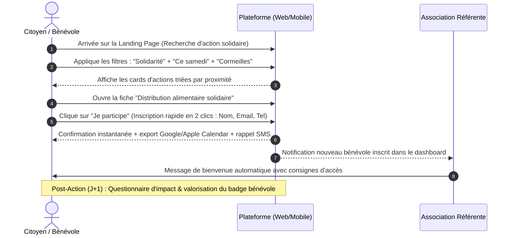
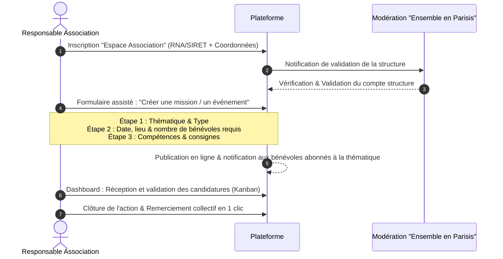

# 📋 Spécifications Produit & Dossier d'Architecture UX/UI
## Plateforme Citoyenne & Solidaire : *Ensemble en Parisis*

---

## 1. Vision & Objectifs de la Plateforme
* **Fédérer et engager** les habitants du bassin de vie (Parisis / Vallée de Montmorency) autour de projets citoyens, solidaires et durables.
* **Faire le pont** entre les citoyens / bénévoles et le tissu associatif local.
* **Proposer un répertoire clair et vivant** d'actions, d'événements et d'initiatives avec une recherche fluide et intuitive.

---

## A. Architecture du site & Navigation (Sitemap, Header & Footer)

### 1. Sitemap Global (Arborescence)

```mermaid
graph TD
    Home[Page d'Accueil]
    
    Home --> Actions[1. Agir & S'engager]
    Actions --> Missions[Catalogue des missions de bénévolat]
    Actions --> Agenda[Agenda des événements & ateliers]
    Actions --> Urgences[Missions urgentes & Coups de main]
    Actions --> Prets[Bourse aux dons & matériels]
    
    Home --> Themes[2. Thématiques]
    Themes --> T1[Environnement & Transition]
    Themes --> T2[Solidarité & Aide sociale]
    Themes --> T3[Vie locale & Citoyenneté]
    Themes --> T4[Éducation & Transmission]
    Themes --> T5[Santé & Prévention]
    Themes --> T6[Culture, Sport & Loisirs]
    
    Home --> Assos[3. Tissu Associatif]
    Assos --> Annuaire[Annuaire des associations locales]
    Assos --> TiersLieux[Carte des tiers-lieux & lieux de vie]
    
    Home --> Projets[4. Projets & Idées]
    Projets --> BoiteIdees[Boîte à idées citoyenne]
    Projets --> Concertations[Consultations locales & Budgets participatifs]
    
    Home --> Mag[5. Actualités & Récits]
    Mag --> Articles[Portraits de bénévoles & Initiatives]
    Mag --> Guides[Guides pratiques de l'engagement]
    
    Home --> Auth[6. Espaces Utilisateurs]
    Auth --> EspaceBenevole[Espace Citoyen / Bénévole]
    Auth --> EspaceAsso[Espace Association & Porteur de projet]
    Auth --> Admin[Back-Office / Modération]
```



---

### 2. Structure de Navigation (Header & Footer)

#### Header (Desktop & Mobile)
* **Barre d'alerte / Notification haute (Sticky fine) :** *« 🌿 Prochain grand ramassage citoyen ce samedi à Cormeilles ! [Participer] »*
* **Logo :** Identité visuelle moderne *"Ensemble en Parisis"* avec baseline dynamique *(« La dynamique citoyenne de notre territoire »)*.
* **Navigation Principale (Mega-Menu) :**
  * **Agir :** Toutes les missions, Agenda, Coups de main express, Dons.
  * **Thématiques :** Accès direct aux 6 piliers thématiques.
  * **Associations :** Annuaire, Carte interactive des structures.
  * **Projets citoyens :** Idées, concertations en cours.
* **Barre d'outils & CTA (Droite) :**
  * 🔍 *Recherche rapide (icône modale / Cmd+K)*
  * 👤 *Connexion / Mon Espace*
  * **CTA Secondaire (Contour / Ghost) :** `+ Proposer une action` (déclenche un routage vers Asso ou Porteur de projet citoyen).
  * **CTA Primaire (Plein / Accent vert-émeraude) :** `Rejoindre une mission` / `Devenir bénévole`.

#### Footer (Pied de page riche)
* **Colonne 1 - Identité & Mission :** Logo, raison d'être, label d'utilité citoyenne, réseaux sociaux locaux (Instagram, Facebook, Discord/WhatsApp communautaire).
* **Colonne 2 - Explorer par Thématique :** Liens directs vers les 6 axes (Transition, Solidarité, Vie locale, etc.).
* **Colonne 3 - Passer à l'action :** Trouver une mission, Calendrier du week-end, Donner du matériel, Proposer une idée.
* **Colonne 4 - Pour les Associations & Partenaires :** Créer un compte structure, Référencer une mission, Kit de communication, Espace Mairies/Collectivités.
* **Colonne 5 - Newsletter d'impact local :** Champ email + fréquence personnalisable *(« 1 email tous les 15 jours sur les initiatives près de chez vous »)*.
* **Barre inférieure légale :** Mentions légales, RGPD & Confidentialité, Charte éthique citoyenne, Accessibilité (Conformité RGAA), Plan du site.

---

## B. Typologie d'actions & Système de recherche/filtrage

### 1. Typologie des formats d'engagement

| Type d'action | Description | Engagement temps | Exemple |
| :--- | :--- | :--- | :--- |
| **Bénévolat Ponctuel ("Coup de main")** | Mission courte sans engagement récurrent | 1h à 4h | Aide logistique sur une fête de quartier, distribution de tracts |
| **Bénévolat Régulier** | Mission inscrite dans la durée | 1h à 2h / semaine ou mois | Soutien scolaire, visites hebdomadaires à des aînés isolés |
| **Événement & Atelier** | Rendez-vous ouvert au grand public | Date et heure fixes | Atelier réparation vélo, Fresque du Climat, initiation premiers secours |
| **Don Matériel & Compétence** | Prêt d'outils ou partage ponctuel de savoir-faire | À la demande | Prêt de matériel de jardinage, aide informatique bénévole |
| **Consultation / Idée citoyenne** | Participation à un débat ou projet de quartier | Asynchrone (en ligne) | Vote pour l'aménagement d'un espace vert partagé |

---

### 2. Système de Recherche & Filtres Multicritères

Le composant de recherche repose sur une **barre universelle contextuelle** couplée à une **sidebar de filtres à facettes** (avec mise à jour des résultats en temps réel sans rechargement de page).

```
[ 🔍 Mot-clé, asso... ]  [ 📍 Commune / Quartier ▾ ]  [ 🏷️ Thématique ▾ ]  [ 📅 Disponibilité ▾ ]  [ Bouton : Filtrer ]
```

#### Liste détaillée des filtres :
1. **Thématique (6 badges couleur cliquables) :**
   * 🟢 *Environnement & Transition écologique*
   * 🟠 *Solidarité & Aide aux personnes*
   * 🔵 *Vie locale & Citoyenneté*
   * 🟣 *Éducation & Transmission*
   * 🔴 *Santé, Bien-être & Prévention*
   * 🟡 *Culture, Sport & Loisirs solidaires*
2. **Niveau d'engagement & Format :**
   * Ponctuel (< 1 demi-journée) | Régulier | En présentiel | À distance / Hybride | Urgence (Besoin sous 48h).
3. **Localisation / Communes du territoire :**
   * Sélecteur multi-villes (ex: Cormeilles-en-Parisis, Herblay-sur-Seine, Franconville, Taverny, Sannois, Montigny-lès-Cormeilles...) + Rayon kilométrique (1 km, 5 km, 10 km).
4. **Disponibilités & Calendrier :**
   * Ce week-end | En semaine | En soirée | Pendant les vacances scolaires | Date spécifique (Datepicker).
5. **Accessibilité & Publics :**
   * Accessible aux débutants (sans formation préalable) | Ouvert aux mineurs / ados | En famille (avec enfants) | Accessible PMR.
6. **Modes d'affichage :**
   * `Vue Grille de cartes` | `Vue Carte interactive géolocalisée` | `Vue Calendrier chronologique`.

---

## C. Parcours Utilisateurs (User Journeys)

### Parcours 1 : Citoyen / Bénévole



* **Sous-parcours "Sans friction" :** Possibilité de s'inscrire à une mission ponctuelle en mode *Guest Checkout* (création de compte différée avec lien magique par e-mail).
* **Espace Citoyen :** Tableau de bord affichant l'historique des actions, le compteur d'heures solidaires cumulées, les badges citoyens et les favoris.

---

### Parcours 2 : Association / Porteur de projet



* **Outils clés pour l'association :**
  * Export des listes de bénévoles au format CSV/PDF (pour émargement terrain).
  * Messagerie directe sécurisée avec les participants.
  * Duplication d'actions passées en un clic pour les événements récurrents.

---

## D. Wireframe & Structure de la Page d'Accueil (Landing Page)

```
+-----------------------------------------------------------------------------------+
| [Bandeau Info Urgence / Actu] "Grand ramassage citoyen samedi ! En savoir plus >" |
+-----------------------------------------------------------------------------------+
| [LOGO Ensemble en Parisis]     Agir  Thématiques  Assos  Projets   [+ Proposer] [Agir] |
+-----------------------------------------------------------------------------------+
|                                                                                   |
|  SECTION 1: HERO SECTION                                                          |
|  "Faites bouger votre territoire, à votre rythme."                                |
|  Rejoignez des centaines de citoyens et associations engagés en Parisis.          |
|                                                                                   |
|  +-----------------------------------------------------------------------------+  |
|  | [🔍 Que voulez-vous faire ?] [📍 Ville ▾] [🏷️ Thématique ▾] [ 🚀 Explorer ] |  |
|  +-----------------------------------------------------------------------------+  |
|  Tags populaires : #Maraude #JardinPartagé #ZéroDéchet #SoutienScolaire          |
|                                                                                   |
+-----------------------------------------------------------------------------------+
|                                                                                   |
|  SECTION 2: MÉTRIQUES D'IMPACT EN TEMPS RÉEL (Bandeau de réassurance)             |
|  [ 120+ Assos actives ]  [ 2 450 Heures solidaires ]  [ 85 Actions ce mois-ci ]   |
|                                                                                   |
+-----------------------------------------------------------------------------------+
|                                                                                   |
|  SECTION 3: LES 6 THÉMATIQUES PHARES (Grille interactive 2x3)                    |
|  +---------------------+ +---------------------+ +---------------------+         |
|  | 🌿 Environnement    | | 🤝 Solidarité       | | 🏛️ Vie locale       |         |
|  | 14 actions en cours | | 22 actions en cours | | 8 consultations     |         |
|  +---------------------+ +---------------------+ +---------------------+         |
|  +---------------------+ +---------------------+ +---------------------+         |
|  | 📚 Éducation        | | 🩺 Santé & Bien-être| | 🎭 Culture & Sport  |         |
|  | 9 actions en cours  | | 6 ateliers          | | 18 événements       |         |
|  +---------------------+ +---------------------+ +---------------------+         |
|                                                                                   |
+-----------------------------------------------------------------------------------+
|                                                                                   |
|  SECTION 4: ACTIONS DU MOMENT & COUPS DE MAIN DU WEEK-END                         |
|  Titre : "Où agir ce week-end près de chez vous ?"               [Voir tout (42)] |
|                                                                                   |
|  +-------------------+  +-------------------+  +-------------------+              |
|  | [Photo / Badge]   |  | [Photo / Badge]   |  | [Photo / Badge]   |              |
|  | 🌿 Environnement  |  | 🤝 Solidarité     |  | 📚 Éducation      |              |
|  | Nettoyage berges  |  | Distribution repas|  | Atelier Code Ados |              |
|  | 📍 Herblay | Sam 14h|  | 📍 Franconville   |  | 📍 Cormeilles     |              |
|  | 👥 Reste 3 places |  | 👥 Reste 5 places |  | 👥 Reste 2 places |              |
|  | [ Je participe ]  |  | [ Je participe ]  |  | [ Je participe ]  |              |
|  +-------------------+  +-------------------+  +-------------------+              |
|                                                                                   |
+-----------------------------------------------------------------------------------+
|                                                                                   |
|  SECTION 5: CARTE INTERACTIVE DU TERRITOIRE (Mapbox / OpenStreetMap)              |
|  "Découvrez les initiatives, tiers-lieux et associations autour de vous"          |
|  [ Carte interactive avec pins cliquables par thématique + fiche aperçu latérale]|
|                                                                                   |
+-----------------------------------------------------------------------------------+
|                                                                                   |
|  SECTION 6: DOUBLE BLOC CTA (Convertir les deux cibles)                          |
|  +-------------------------------------+ +-------------------------------------+  |
|  | 🙋 VOUS ÊTES UN HABITANT ?          | | 🏢 VOUS ÊTES UNE ASSOCIATION ?      |  |
|  | Trouvez une action adaptée à votre  | | Publiez vos besoins de bénévoles,   |  |
|  | planning et faites des rencontres.  | | gagnez en visibilité et fédérez.    |  |
|  | [ Trouver ma 1ère mission ]         | | [ Référencer mon association ]      |  |
|  +-------------------------------------+ +-------------------------------------+  |
|                                                                                   |
+-----------------------------------------------------------------------------------+
|                                                                                   |
|  SECTION 7: HISTOIRES D'ENGAGEMENT (Récits & Témoignages vidéo/citations)         |
|  "Ils font vivre le Parisis" -> Témoignages croisés : Bénévoles & Porteurs de proj|
|                                                                                   |
+-----------------------------------------------------------------------------------+
|                                                                                   |
|  SECTION 8: NEWSLETTER LOCALE & FOOTER COMPLET                                    |
|  "Restez connectés à la vie de votre territoire" -> [ Champ email ] [ S'inscrire ]|
|  [ Liens thématiques | Espaces asso | Mentions légales | RGAA ]                   |
+-----------------------------------------------------------------------------------+
```

---

## E. Spécifications UI/UX & Recommandations Techniques

### 1. Direction Artistique & Identité Visuelle

* **Atmosphère générale :** Chaleureuse, vivante, inclusive, résolument citoyenne sans être austère ni institutionnelle.
* **Typographie :**
  * *Titres & Display :* **Outfit** ou **Plus Jakarta Sans** (géométrique, moderne et très accessible).
  * *Corps de texte :* **Inter** (lisibilité optimale sur écrans mobiles et contrastes élevés).
* **Palette Chromatique :**
  * **Couleurs Structurelles :**
    * Fond principal : Blanc chaud `#FAFAF9` (Stone-50) & Ardoise foncée `#0F172A` pour les textes.
    * Couleur d'accentuation Primaire : Vert Émeraude Citoyen `#059669` (symbole d'action, de renouveau et d'espoir).
    * Couleur Secondaire : Indigo Chaleureux `#4F46E5` (institutionnel doux et fédérateur).
  * **Code Couleur par Thématique (Accessibilité WCAG AAA) :**
    1. *Environnement & Transition :* Vert Feuille `#16A34A`
    2. *Solidarité & Aide :* Orange Corail `#EA580C`
    3. *Vie locale & Citoyenneté :* Bleu Azur `#0284C7`
    4. *Éducation & Transmission :* Violet Améthyste `#7C3AED`
    5. *Santé & Prévention :* Rose Framboise `#E11D48`
    6. *Culture, Sport & Loisirs :* Jaune Ambre `#D97706`

### 2. Normes d'Accessibilité (RGAA / WCAG 2.1 niveau AA)
* Ratios de contraste minimum : 4.5:1 pour le texte standard, 3:1 pour les grands titres et éléments UI interactifs.
* Navigation 100% au clavier (Focus indicators bien visibles, liens d'évitement "Aller au contenu").
* Balisage sémantique strict (`<main>`, `<nav>`, `<article>`, `<header>`, `aria-labels` explicites pour les filtres et modales).
* Textes alternatifs obligatoires (`alt=""`) pour toutes les images d'annonces.

---

### 3. Architecture Technique & Choix de Stack

#### 🏆 Option Recommandée : Stack Web Moderne (Performance, Évolutivité & SEO local)

```
[ Frontend : Next.js 14+ (App Router) + Tailwind CSS + Radix UI / Shadcn UI ]
                                    │
                                    ▼
[ Backend / BaaS : Supabase (PostgreSQL + Auth + Row Level Security + Storage) ]
                                    │
    ┌───────────────────────────────┼───────────────────────────────┐
    ▼                               ▼                               ▼
[ Cartographie : Mapbox / Leaflet ] [ Emails : Resend + React Email ] [ Recherche : Meilisearch / Algolia ]
```

* **Frontend (Next.js + Tailwind CSS) :**
  * Rendu hybride (SSG pour le répertoire d'associations et le SEO local par commune, SSR/ISR pour les missions en temps réel).
  * Composants accessibles et modulaires avec **Shadcn UI** (Radix UI sous le capot).
* **Backend & Base de données (Supabase / PostgreSQL) :**
  * Authentification unifiée (Magic Link sans mot de passe pour les citoyens, Auth avec rôles pour les assos/admins).
  * *Row Level Security (RLS)* : Garantit l'isolation stricte des données entre associations.
  * Stockage d'images (photos des actions et logos des associations) avec redimensionnement automatique.
* **Services Tiers Complémentaires :**
  * **Cartographie :** OpenStreetMap via *Leaflet.js* (Open Source, gratuit) ou *Mapbox GL*.
  * **Gestion des emails / notifications :** *Resend* (ou Brevo) pour les confirmations d'inscription et alertes SMS.
  * **Moteur de recherche temps réel :** PostgreSQL Full-Text Search (ou *Meilisearch* pour une tolérance instantanée aux fautes de frappe).

#### 💡 Alternative No-Code / Low-Code (Déploiement ultra-rapide < 3 semaines)
* **Webflow** (pour le design frontend et le CMS vitrine) + **Wized / Supabase** (pour la logique de filtrage et les comptes utilisateurs) ou solution packagée **WordPress + ACF + FacetWP**.

---

## F. Synthèse des KPIs & Métriques de succès du produit

1. **Taux de conversion citoyenne :** % de visiteurs uniques qui finalisent une inscription à une action.
2. **Diversité territoriale :** Répartition équilibrée des missions sur l'ensemble des communes du Parisis.
3. **Taux de rétention bénévole :** Nombre de citoyens effectuant plus de 2 actions par trimestre.
4. **Taux de satisfaction association :** Temps moyen pour combler un besoin de bénévoles (objectif : < 72h pour les urgences).
